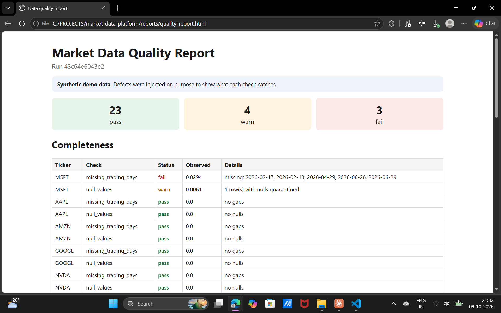

# Market Data Quality Platform

A data-engineering project that ingests market data from several sources, checks it for **completeness, accuracy, timeliness and reliability**, quarantines bad rows instead of loading them, builds curated datasets, and serves them through a secured REST API with an HTML quality report.

> **Data note:** the demo and the test suite run on **synthetic data with deliberately planted defects**, so every check can be verified against a known answer. It is not real market data, and no result in this repository should be read as a real market statistic.



---

## Why this project exists

Companies that sell data are judged on whether it is right and on time. One wrong price or a missing day reaches every customer. A pipeline that only moves data is not enough: it has to **prove** the data is trustworthy and set aside whatever is not. This project builds that guarantee as code. Every run is logged, every check result is stored, and every rejected row is kept with a reason.

## Key features

- **Layered warehouse (DuckDB):** raw (append-only) → silver (validated, deduplicated) → gold (curated metrics).
- **Quarantine, never silent deletion:** invalid rows are stored with a reason (`null_value`, `non_positive_price`, `negative_volume`, `ohlc_inconsistent`).
- **Six automated quality checks** across four dimensions (see below).
- **Idempotent rebuilds:** re-running the same inputs produces identical silver and gold tables.
- **Corporate-action-aware accuracy check:** a 75% price drop is accepted when a 4:1 split explains it, and flagged when nothing does.
- **Anomaly explanations:** deterministic rules always work; an optional LLM can rewrite the explanation, and the rules take over if it is unavailable.
- **REST API (FastAPI)** with API-key authentication and a five-layer SQL safety guard for user- and LLM-written queries.
- **Static HTML quality report** for non-technical readers.
- **34 automated tests** (pytest).

## Architecture

```
 Sources                         DuckDB warehouse                               Consumers
 ───────                         ────────────────                               ─────────
 Prices            ─┐       raw_prices / raw_corporate_actions / raw_attention
 Corporate actions ─┼──►    (append-only: every delivery kept, with run_id + timestamp)
 Attention data    ─┘                         │
 (synthetic demo)                             ▼
                              silver_prices / silver_corporate_actions / silver_attention
                              quarantine_prices  (rejected rows + reason)
                                              │
                                              ▼
                              gold_daily_metrics
                              (daily return, 20-day volatility, 20-day avg volume, attention z-score)
                                              │
                                              ▼
                              dq_results · dq_anomalies · pipeline_runs
                                              │
                         ┌────────────────────┼─────────────────────┐
                         ▼                    ▼                     ▼
                   HTML quality report     REST API       natural-language /ask
```

### One pipeline run

1. Log the run as `running` in `pipeline_runs`.
2. **Ingest:** validate each source's schema (fail early), stamp rows with `run_id` and `ingested_at`, append to the raw tables.
3. **Silver:** flag each row with a validity reason. Keep one row per `(ticker, day)`, preferring a **valid** row over an invalid one and then the most recent. A corrupted re-delivery therefore cannot overwrite a good earlier load. Rejected rows go to quarantine.
4. **Gold:** SQL window functions build the curated metrics.
5. **Quality checks:** run all checks and store the results.
6. **Explain:** write an explanation for every flagged price jump.
7. Mark the run `success`, or record the error, mark it `failed` and re-raise.

## Data quality checks

| Dimension | Check | What it looks for |
|---|---|---|
| Completeness | `missing_trading_days` | Gaps per ticker. A day counts as a trading day if at least half the tickers have data, so market holidays are not flagged but a single ticker's gap is. Any gap warns; more than 2% of days fails. |
| Completeness | `null_values` | Rows with missing prices or volume. |
| Accuracy | `ohlc_validity` | Impossible rows (low above high, non-positive prices, negative volume). |
| Accuracy | `unexplained_price_jumps` | Daily moves above 25%. A jump is *explained* only if a matching stock split exists within three days. |
| Timeliness | `freshness_lag_business_days` | Business days since the latest data, against an SLA of 3 days. |
| Reliability | `conflicting_duplicates` | The same ticker and day delivered more than once with different values. Identical duplicates are harmless. |

All thresholds are configurable in `config/config.yaml`.

## Demo result (synthetic data, planted defects)

839 price rows delivered → 836 curated → **3 quarantined**. 30 checks ran: **23 pass, 4 warn, 3 fail**. Two anomalies were explained.

| Planted defect | How the platform handled it |
|---|---|
| MSFT: 5 missing trading days and 1 null volume | Completeness **fail**; null-value warning; row quarantined |
| AMZN: feed stopped 7 business days early | Timeliness **fail** |
| GOOGL: +38% jump with no corporate action | Unexplained-jump **fail**; explanation cites the volume and attention spike |
| NVDA: genuine 4:1 split (−75%) | Jump **explained**, no failure |
| NVDA: a row with low above high | Quarantined; accuracy warning |
| AAPL: one day re-delivered with corrupted values | Good first load kept; conflict warning; corrupted row quarantined |
| Market holidays (missing for every ticker) | Correctly **not** flagged |

## Quick start

Requires Python 3.10 or newer.

**Windows (PowerShell)**

```powershell
python -m venv .venv
.venv\Scripts\Activate.ps1
pip install -r requirements.txt
$env:PYTHONPATH = "src"

python -m mdp demo      # run the pipeline on synthetic data and build the report
python -m mdp serve     # start the API at http://127.0.0.1:8000/docs
pytest -q               # run the test suite
```

**macOS / Linux**

```bash
python3 -m venv .venv
source .venv/bin/activate
pip install -r requirements.txt
export PYTHONPATH=src

python -m mdp demo
python -m mdp serve
pytest -q
```

`python -m mdp demo` writes `data/warehouse.duckdb` and `reports/quality_report.html`. It deletes any previous demo database first, so each demo run is repeatable. Use `python -m mdp report` to rebuild the HTML report from an existing warehouse.

## REST API

Interactive documentation is served at `/docs` when the server is running.

| Method | Endpoint | Description |
|---|---|---|
| GET | `/health` | Liveness check |
| GET | `/datasets` | Row count, ticker count and date range of the gold table |
| GET | `/prices/{ticker}` | Daily metrics for a ticker (`start`, `end`, `limit` parameters) |
| GET | `/quality/summary` | Pass/warn/fail counts per dimension for the latest run |
| GET | `/quality/results` | Detailed check results, optionally filtered by `status` |
| GET | `/quality/anomalies` | Flagged price jumps with explanations |
| POST | `/query` | Run a read-only `SELECT` through the SQL guard |
| POST | `/ask` | Ask a question in plain English (requires an LLM) |

**Configuration (environment variables)**

| Variable | Purpose |
|---|---|
| `MDP_DB` | Path to the DuckDB file (default `data/warehouse.duckdb`) |
| `MDP_API_KEY` | If set, every request must send a matching `X-API-Key` header |
| `LLM_API_KEY`, `LLM_BASE_URL`, `LLM_MODEL` | Enable the optional LLM features (any OpenAI-compatible chat endpoint) |

### SQL safety

`/query` and `/ask` accept SQL, which is untrusted input. Defence in depth:

1. Only a single `SELECT` / `WITH` statement is allowed; comments and multiple statements are refused.
2. Write, DDL and file-access keywords and functions are rejected.
3. Only allow-listed tables can be read (`gold_daily_metrics`, `dq_results`, `dq_anomalies`).
4. A `LIMIT` of at most 500 rows is always enforced.
5. Queries run on a **read-only connection with external file access disabled**, so the database cannot be changed even if a check is bypassed.

### The optional AI layer

Rules always produce an explanation for a flagged jump (split, volume spike, attention spike, or "more likely a data error"). If the LLM variables are set, a model may rewrite that explanation. It only receives facts the pipeline computed and can only return text. If it is unavailable or fails, the rules are used, so the platform never depends on a model.

## Project structure

```
market-data-platform/
├── config/config.yaml         # tickers and check thresholds
├── src/mdp/
│   ├── config.py              # settings and defaults
│   ├── schemas.py             # expected columns per source, validated at ingestion
│   ├── storage.py             # DuckDB connection and table definitions
│   ├── sources/synthetic.py   # synthetic data with planted defects
│   ├── transform.py           # raw → silver → gold (SQL)
│   ├── checks.py              # the six quality checks
│   ├── explain.py, llm.py     # anomaly explanations (rules + optional LLM)
│   ├── pipeline.py            # orchestrates one run
│   ├── report.py              # static HTML report
│   ├── sql_guard.py, ask.py   # SQL safety layer and natural-language queries
│   ├── api.py                 # FastAPI service
│   └── cli.py, __main__.py    # command-line interface
├── tests/                     # 34 pytest tests
├── docs/                      # screenshots
├── pyproject.toml
└── requirements.txt
```

## Testing

`pytest -q` runs 34 tests:

- **Checks (5):** each check on small hand-built inputs with a known answer, including the holiday and split cases.
- **Pipeline (5):** each planted defect is caught and nothing extra is flagged; rejected rows are quarantined; a bad late load cannot overwrite a good row; reruns are idempotent; a schema violation fails the run and is logged.
- **SQL guard (14):** allowed and refused queries, limit capping, and string literals containing semicolons.
- **Explanations and LLM (4):** each rule branch, NaN handling, and the LLM-available and LLM-failed paths (using mocks).
- **API (6):** endpoints, status codes, input validation, SQL refusal and API-key enforcement.

## Design decisions

- **Raw is append-only; silver and gold are rebuilt.** Reruns are safe, and the raw layer is an audit trail of exactly what each source sent and when.
- **Quarantine instead of delete.** Bad data stays visible, with a reason.
- **The latest valid row wins**, not simply the latest. An earlier version let a corrupted re-delivery overwrite a good row; the ordering was changed to prefer valid rows.
- **Holiday handling without a calendar dependency:** the half-of-tickers rule is simple and testable.
- **Rules before AI.** Deterministic behaviour is cheap, testable and always available; the model is an optional improvement.

## Limitations

- The demo, tests and attention data are **synthetic**. No live data source is connected in this version.
- The LLM paths are tested with mocks only; they have not been exercised against a real model here.
- Prices are unadjusted; the jump check relies on corporate actions to explain splits instead of adjusting history.
- The holiday rule needs three or more tickers; with fewer, it falls back to plain business days. A real exchange calendar would be more exact.
- Fixed thresholds can misjudge a volatile stock that legitimately moves more than 25%.
- Batch only, on a single-node DuckDB file. There is no scheduler or alerting.

## Roadmap

Live sources (market data API and Wikipedia page views as an alternative-data proxy), an orchestrator such as Airflow or Prefect, incremental silver and gold builds, per-ticker adaptive thresholds, adjusted prices, an exchange calendar, and alerting on failed checks.

## Author

**Siddiqua Fathima**: [GitHub](https://github.com/siddiquafathima) · [LinkedIn](https://www.linkedin.com/in/siddiqua-fathima-126b98212)

